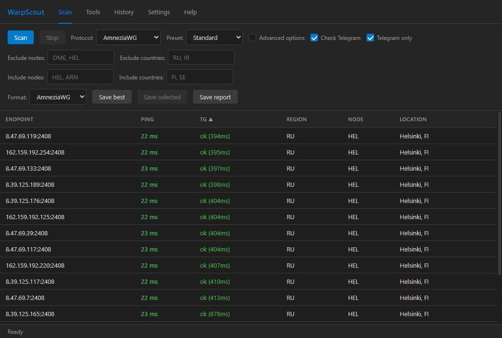
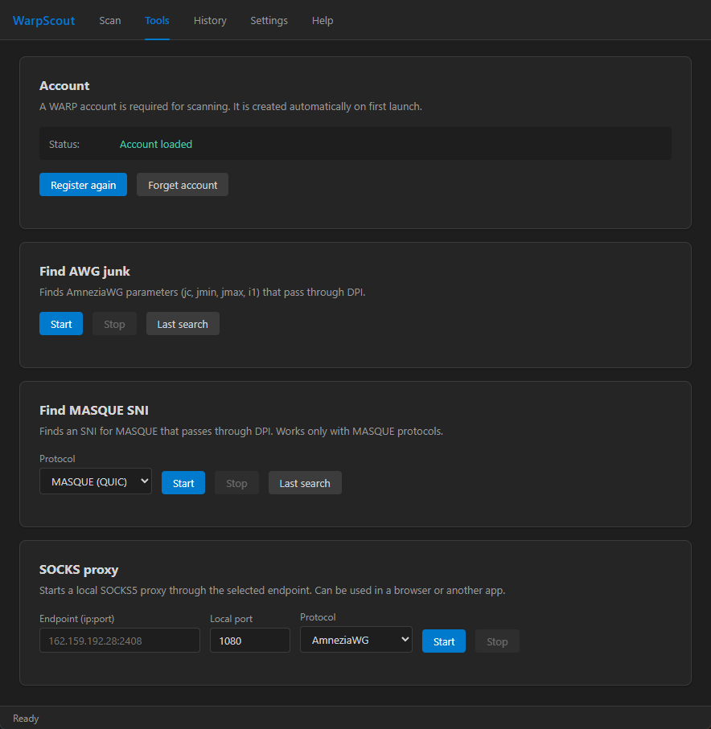
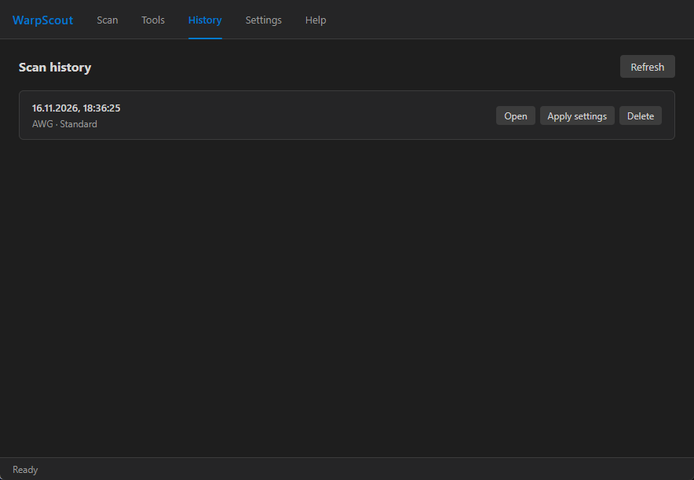
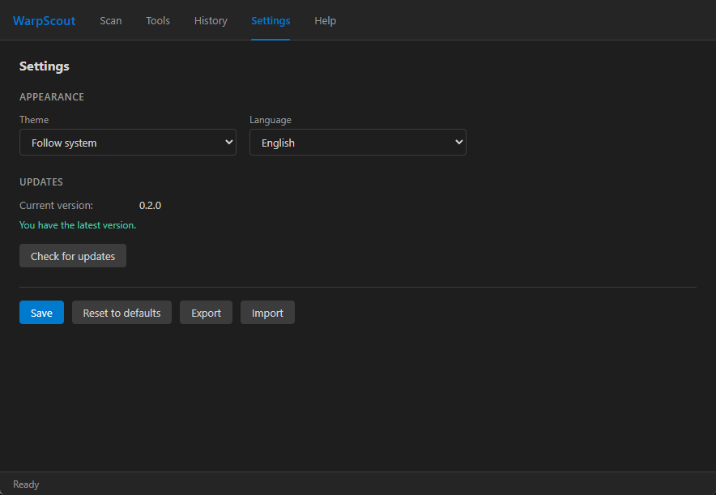

# WarpScout GUI

A graphical interface for the original command-line tool [WarpScout](https://github.com/vernette/warpscout). Built with Go and the Wails framework.

The project integrates code from other forks, eliminating the need to manually configure parameters via the command line.

[Читать на русском](README.ru.md)


> The application runs on Windows 10/11 only. Administrator rights are not required.

## Features from other forks

* **Synced with Android version.** The scanner logic is updated to match the latest [warpscout-android](https://github.com/openwarpkit/warpscout-android) (v1.5.2). This includes not only the automatic I1 selection, but also the updated API for account registration (`api.devices.cloudflare.com`), as well as other changes in result processing and network handling.
* **Telegram Check.** Taken from [warpscout-tg](https://github.com/niklzz/warpscout-tg). The app sends actual requests to Telegram servers to check DPI bypass, rather than just verifying a TCP connection.

## Features

* **Protocols:** AmneziaWG, WireGuard, MASQUE.
* **Scanning:** Custom subnets (CIDR), port sweeping, nested tunnels (WARP-in-WARP).
* **Filtering:** Exclusion of specific nodes (e.g., DME) or countries (e.g., RU).
* **Tools:** AWG Junk search, MASQUE SNI search, custom I1 generator, local SOCKS5 proxy.
* **Export:** Save configurations for AmneziaWG, WireGuard, usque, and Mihomo.
* **UI:** 6 themes, localization (RU/EN), color-coded ping and Telegram status.

## Screenshots









## Usage

1. Download `WarpScoutGUI-windows.exe` from the [Releases](https://github.com/3inker/warpscout-gui/releases/latest) page.
2. Run the file. On the first launch, the app will automatically register a WARP account (takes about 30 seconds).
3. Select the desired protocol in the top panel, optionally enable `Check Telegram`, and click `Scan`.
4. To save a configuration, right-click on a suitable endpoint and select the desired format.

App data (settings, history, account) is stored in `%APPDATA%\WarpScout\`.

### Protocols

Besides AmneziaWG, the app supports **WireGuard** and **MASQUE (QUIC/TCP)**. The scanning protocol is selected from the dropdown in the top panel. For MASQUE, scanning works through the built-in client, but using the generated `usque` config requires a separate program.

### Where to import the generated configs

**AmneziaWG (`.conf`)** – for the [AmneziaWG](https://docs.amnezia.org/documentation/amnezia-wg/) client:
1. Open the AmneziaWG app.
2. Click **Add Tunnel**.
3. Select **Import tunnel from file** and choose your saved `.conf` file.

**WireGuard (`.conf`)** – for the official [WireGuard](https://www.wireguard.com/install/) client:
1. Open the WireGuard app.
2. Click **Import tunnel from file**.
3. Select your `.conf` file and click **Open**.

**usque (`.json`)** – for the [usque](https://github.com/Diniboy1123/usque) client:
1. Save `config.json` to the same folder as the `usque.exe` executable.
2. Start the proxy with: `usque.exe -c config.json socks -b 127.0.0.1 -p 1080`.

**Mihomo (`.yaml`)** – for clients based on the [Mihomo](https://github.com/MetaCubeX/mihomo) core (e.g., Clash Verge Rev):
1. Place the `.yaml` file in the client's configuration folder.
2. Activate the profile in the UI and enable system proxy or TUN mode.

## Build from source

Requirements: Go 1.26.3+, Node.js 20+, Wails CLI v2.15.0.

```bash
git clone https://github.com/3inker/warpscout-gui.git
cd warpscout-gui/gui

# Run in development mode
wails dev

# Build the executable
wails build
```

## Credits

* [vernette/warpscout](https://github.com/vernette/warpscout) – original CLI.
* [openwarpkit/warpscout-android](https://github.com/openwarpkit/warpscout-android) – tools and mechanics used from the Android version.
* [niklzz/warpscout-tg](https://github.com/niklzz/warpscout-tg) – Telegram check implementation.