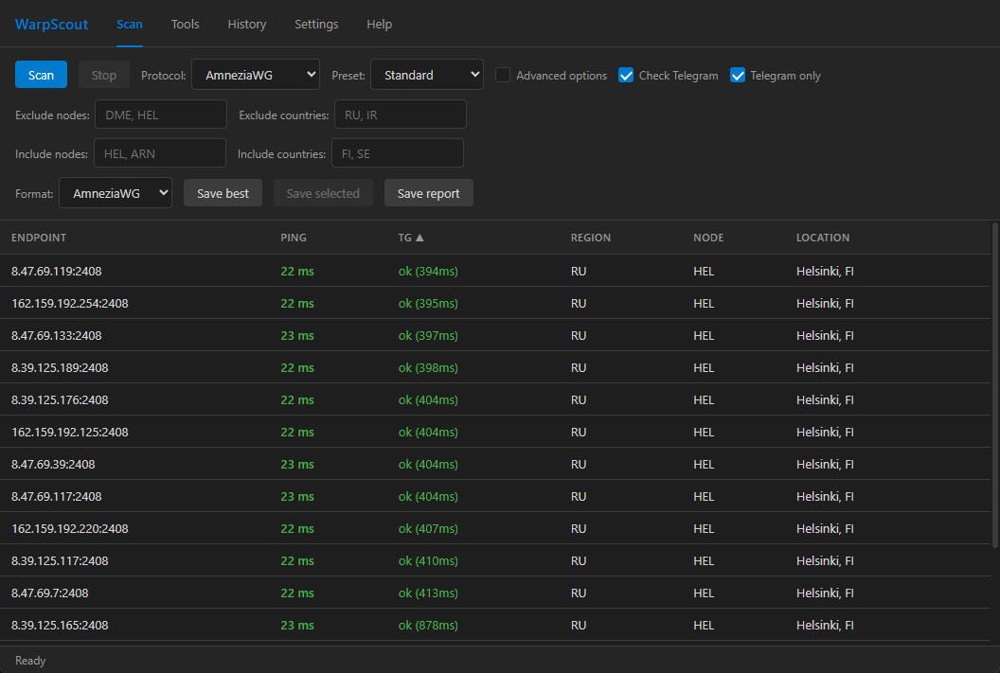
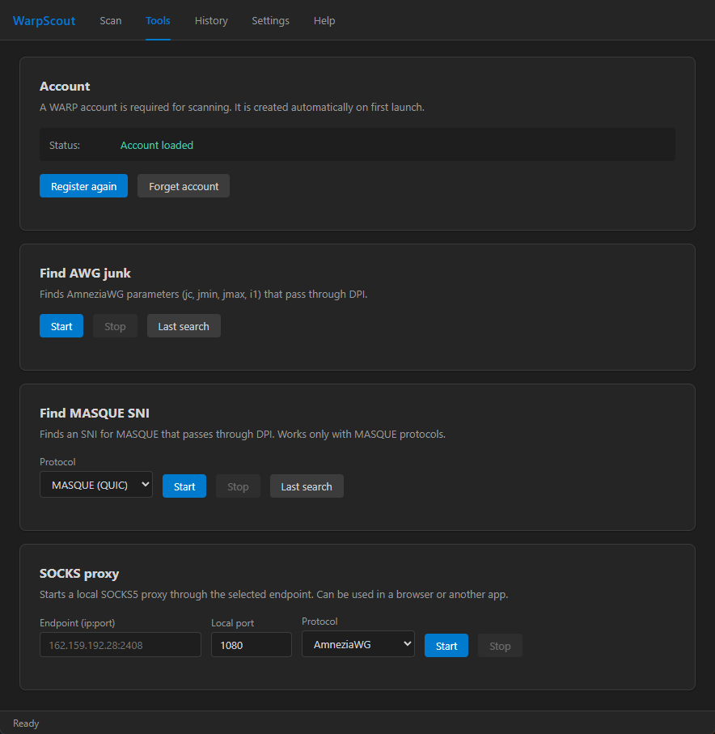
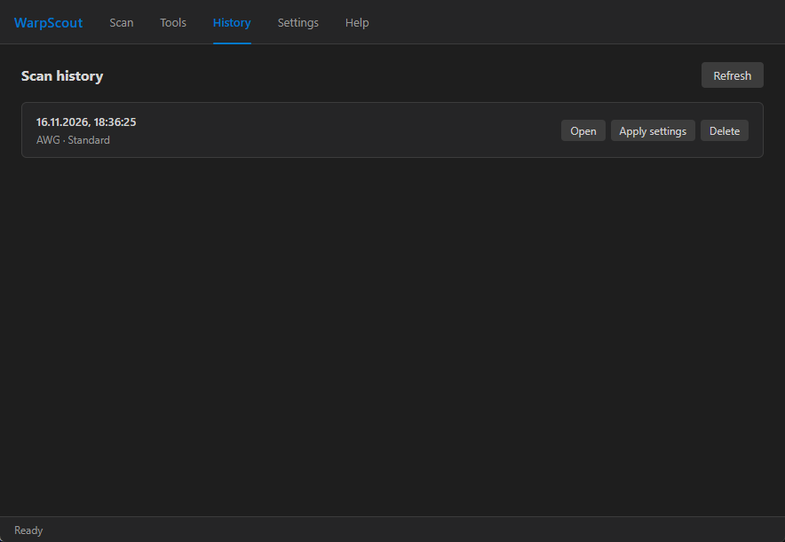
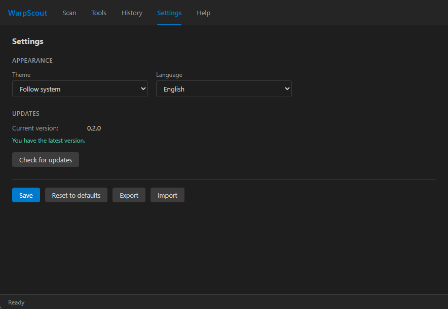

# WarpScout GUI

Графическая оболочка для оригинального консольного инструмента [WarpScout](https://github.com/vernette/warpscout). Написана на Go с использованием фреймворка Wails.

В проект интегрирован код из других форков, чтобы не приходилось вручную настраивать параметры в командной строке.

[Read in English](README.md)


> Приложение работает только на Windows 10/11. Права администратора не требуются.

## Функции из других форков

* **Синхронизация с Android-версией.** Логика работы сканера обновлена до актуального состояния [warpscout-android](https://github.com/openwarpkit/warpscout-android) (v1.5.2). Это включает в себя не только автоматический подбор I1, но и обновленный API для регистрации аккаунтов (`api.devices.cloudflare.com`), а также другие изменения в обработке результатов и работе с сетью.
* **Проверка Telegram.** Взято из [warpscout-tg](https://github.com/niklzz/warpscout-tg). Программа отправляет реальные запросы на серверы Telegram, чтобы проверить обход блокировок (DPI), а не просто проверяет наличие TCP-соединения.

## Возможности

* **Протоколы:** AmneziaWG, WireGuard, MASQUE.
* **Сканирование:** Свои подсети (CIDR), перебор портов, вложенные туннели (WARP-in-WARP).
* **Фильтрация:** Исключение конкретных узлов (например, DME) или стран (например, RU).
* **Инструменты:** Поиск параметров AWG Junk, поиск MASQUE SNI, генератор I1, локальный SOCKS5-прокси.
* **Экспорт:** Сохранение конфигураций для AmneziaWG, WireGuard, usque и Mihomo.
* **Интерфейс:** 6 тем, локализация (RU/EN), цветовой статус пинга и Telegram.

## Скриншоты









## Использование

1. Скачайте `WarpScoutGUI-windows.exe` со страницы [Releases](https://github.com/3inker/warpscout-gui/releases/latest).
2. Запустите файл. При первом запуске программа автоматически зарегистрирует аккаунт WARP (занимает около 30 секунд).
3. Выберите нужный протокол в верхней панели, при необходимости включите `Проверять Telegram` и нажмите `Сканировать`.
4. Для сохранения конфигурации нажмите правой кнопкой мыши на подходящий эндпоинт и выберите нужный формат.

Данные приложения (настройки, история, аккаунт) хранятся в `%APPDATA%\WarpScout\`.

### Протоколы

Помимо AmneziaWG, приложение поддерживает **WireGuard** и **MASQUE (QUIC/TCP)**. Протокол для сканирования выбирается в выпадающем списке в верхней панели. Для MASQUE сканирование работает через встроенный клиент, а для использования готового конфига `usque` потребуется отдельная программа.

### Куда загружать готовые конфиги

**AmneziaWG (`.conf`)** – для клиента [AmneziaWG](https://docs.amnezia.org/documentation/amnezia-wg/):
1. Откройте приложение AmneziaWG.
2. Нажмите «Добавить туннель» (Add Tunnel).
3. Выберите «Импорт туннелей из файла» (Import tunnel from file) и укажите сохранённый `.conf` файл.

**WireGuard (`.conf`)** – для официального клиента [WireGuard](https://www.wireguard.com/install/):
1. Откройте приложение WireGuard.
2. Нажмите «Импорт туннелей из файла» (Import tunnel from file).
3. Выберите ваш `.conf` файл и нажмите «Открыть».

**usque (`.json`)** – для клиента [usque](https://github.com/Diniboy1123/usque):
1. Сохраните `config.json` в папку с исполняемым файлом `usque.exe`.
2. Запустите прокси командой: `usque.exe -c config.json socks -b 127.0.0.1 -p 1080`.

**Mihomo (`.yaml`)** – для клиентов на базе ядра [Mihomo](https://github.com/MetaCubeX/mihomo) (например, Clash Verge Rev):
1. Поместите `.yaml` файл в папку с конфигурациями клиента.
2. Активируйте профиль в интерфейсе программы и включите системный прокси или TUN-режим.

## Сборка из исходников

Требования: Go 1.26.3+, Node.js 20+, Wails CLI v2.15.0.

```bash
git clone https://github.com/3inker/warpscout-gui.git
cd warpscout-gui/gui

# Запуск в режиме разработки
wails dev

# Сборка исполняемого файла
wails build
```

## Благодарности

* [vernette/warpscout](https://github.com/vernette/warpscout) – оригинальный CLI.
* [openwarpkit/warpscout-android](https://github.com/openwarpkit/warpscout-android) – использованы инструменты и наработки из Android-версии.
* [niklzz/warpscout-tg](https://github.com/niklzz/warpscout-tg) – реализация проверки Telegram.